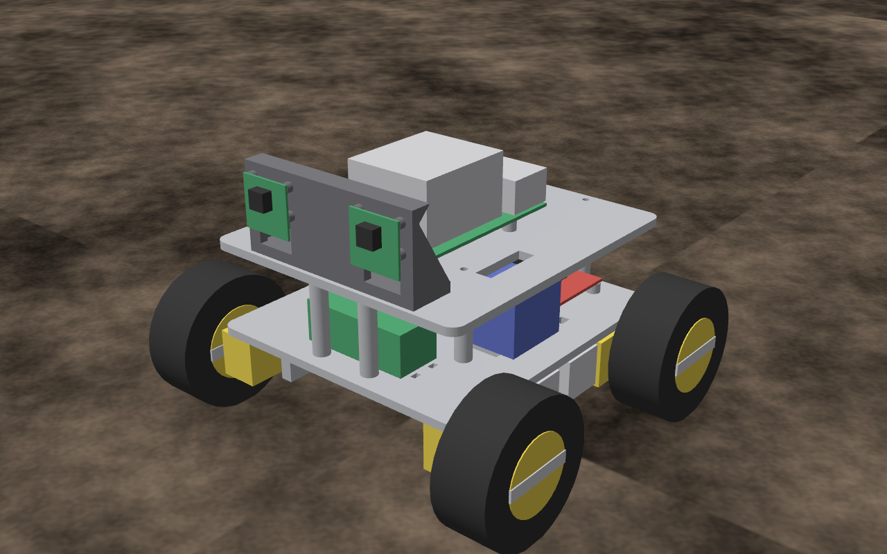

# Ster-Vis test AMR

This is the software for the Ster-Vis test robot's Raspberry Pi 5. The robot is
small: a 4WD skid steer with a 3D-printed chassis, BO gear motors, two L298N
drivers, a 3S LiPo, and two Camera Module 3 on a 60 mm baseline. It sees only
through [Ster-Vis](https://github.com/vixhvajit/Ster-Vis) stereo depth and
steers around whatever the depth shows. The same controller also drives a
Gazebo model of the robot, so you can try it before the hardware exists.



```
Pi cameras -> ster-vis service (depth, HTTP :8080) -> amr: scan -> avoider -> ramp -> L298N PWM
Gazebo     -> Ster-Vis pipeline, same settings   -> amr: scan -> avoider -> ramp -> /amr/cmd_vel
```

**Status:** it has not run on real hardware. What has been tested:
- **Unit tests:** motor mixing, the duty cap, the avoider, and config loading.
- **The Pi's code path, up to the motors:** a real Ster-Vis served recorded
  frames over HTTP and `amr run --dry-run` drove from them.
- **The whole loop in Gazebo:** 180 s runs in an obstacle arena with no
  contacts, at 10 and at 4 frames per second
  ([results](sim/README.md#driving-it-with-the-controller)).

The motor side (gpiozero, lgpio, the L298Ns) has never been run.

## How it works

- **Depth** comes from the `ster-vis` service on the same Pi, through
  `/api/v1/depth.npy`. `amr` builds its own 2D scan from it with Ster-Vis's
  `laser_scan`, in a band from 3 cm above the floor to 5 cm above the lenses.
  It does not use `/api/v1/scan` because that JSON writes "nothing in range"
  and "no depth" as the same `null`, and the avoider must tell a clear path
  from a blind one.
- **Avoidance** is reactive. The nearest hit in a corridor the width of the
  robot sets the speed. Obstacles to either side steer it away. Anything
  closer than 0.30 m ahead makes it stop and turn in place towards the clearer
  side until the way is open. If most of the view straight ahead has no depth,
  it counts as blocked: Ster-Vis cannot match anything nearer than about
  0.26 m, so that close an obstacle shows up as unknown, not clear.
- **Motors:** both motors on a side get the same command. Duty is capped at
  `motor_max_v / (battery_full_v - driver_drop_v)`, which is 0.57 by default,
  so the 6 V BO motors never see much more than 6 V from a full 3S pack. There
  are no encoders, so speed is open loop.
- **Safety:** the motors stop if no fresh depth arrives within 0.5 s, on Ctrl+C
  or SIGTERM, and on any exit. Acceleration is limited. The service is **not**
  enabled at boot.

## On the Pi

1. Install Ster-Vis and calibrate it. Follow its README: `deploy/pi/install.sh`,
   then `ster-vis calibrate`.
2. Install this repo:
   ```bash
   git clone https://github.com/vixhvajit/ster-vis-amr && cd ster-vis-amr
   sudo deploy/pi/install.sh
   sudo cp deploy/pi/ster-vis.env /etc/ster-vis/ster-vis.env && sudo systemctl restart ster-vis
   ```
3. Put the robot on a stand so the wheels are off the ground, then run
   `sudo amr motor-test`. Each wheel should turn forward and then backward. If
   one turns the wrong way, set `invert = true` for it in `/etc/amr/amr.toml`.
4. Run `sudo amr run --dry-run`. This runs the whole loop and prints the motor
   duties without driving.
5. Put it on the floor and run `sudo systemctl start amr`. Stop it with
   `sudo systemctl stop amr`. Logs are in `journalctl -u amr -f`.

### Wiring (defaults; change them in `/etc/amr/amr.toml`)

| Motor | L298N | IN pins (BCM GPIO) |
|---|---|---|
| front left | left board, OUT1/OUT2 | 17 (IN1), 27 (IN2) |
| rear left | left board, OUT3/OUT4 | 22 (IN3), 23 (IN4) |
| front right | right board, OUT1/OUT2 | 5 (IN1), 6 (IN2) |
| rear right | right board, OUT3/OUT4 | 13 (IN3), 19 (IN4) |

Leave the ENA/ENB jumpers on, and the IN pins carry the PWM. Alternatively,
wire EN to a GPIO pin and set `enable = <pin>` for that motor. Connect every
ground together: Pi, both L298Ns and the buck converter. Power the Pi from its
own 5 V 5 A buck converter, not from the L298N's 5 V pin.

### Settings to measure on the real robot

These defaults come from the design, not from measurements:
- `no_load_rpm` (200): sets how speed maps to duty.
- `turn_gain` (1.3): measured on the Gazebo model; the real floor will differ.
- `camera_x_m` and `camera_y_m`: the left lens position in the robot frame.

Also run `ster-vis benchmark` on the Pi. On this PC, Ster-Vis managed about
3 frames per second at the `pi5` preset. Below about 2 per second, the 0.5 s
watchdog will keep stopping the robot. In that case, lower `max_speed` and
raise `scan_timeout_s`.

## Command line

```
amr run [--dry-run] [--duration S] [--log run.csv]    Pi: depth -> avoidance -> motors
amr run --sim [--rate HZ] [--world amr_arena]         the Gazebo model (see sim/)
amr motor-test [--duty 0.6] [--seconds 1]             each motor forward, then backward
amr drive V W SECONDS                                 open-loop drive, then stop
```

Settings are read from `--config`, or from `/etc/amr/amr.toml` when it exists.
Every setting and its meaning is in [`src/amr/config.py`](src/amr/config.py).

## Simulation

[`sim/`](sim/README.md) has the Gazebo Harmonic model, built from the chassis
CAD, plus a test world and an obstacle arena, and the scripts to run
`amr run --sim` and score it.

## Development

```bash
pip install -e .[dev]
pytest
```

## Layout

| Path | What |
|---|---|
| `src/amr/config.py` | Robot settings and TOML loading |
| `src/amr/scan.py` | Scan from a depth map (Ster-Vis `laser_scan`) |
| `src/amr/avoid.py` | Avoider and acceleration ramp |
| `src/amr/motors.py` | Skid-steer mixing, duty mapping, the L298N driver |
| `src/amr/stervis.py` | Depth from the ster-vis service over HTTP |
| `src/amr/sim.py` | Gazebo source, drive and true pose |
| `src/amr/control.py` | The loop and the watchdog |
| `src/amr/cli.py` | The `amr` command |
| `deploy/pi/` | Installer, systemd unit, example config, Ster-Vis settings for this robot |
| `sim/` | Gazebo model, worlds, checks |
| `tests/` | Unit tests |
