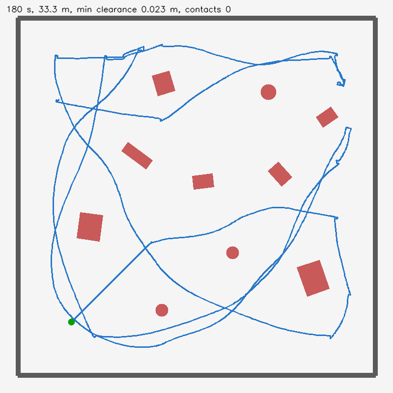

# Ster-Vis test AMR in Gazebo

A Gazebo Harmonic model of the Ster-Vis test AMR, built from its CAD. The design
itself (the Fusion 360 script `chassis.py`, the STLs and the .f3d) is in the
Ster-Vis repo under `hardware/test-amr/`, on the local branch `feat/test-amr`.
It is not on GitHub yet.


## What the model is

- **Printed parts** use the real CAD meshes in their assembled positions:
  the bottom deck with its motor walls, the top deck, the ABS camera mount,
  the deck (with its camera bracket, battery tray and posts) and the camera
  covers and keys.
- **Bought parts** are boxes, the same size as the stand-ins in `chassis.py`:
  4 BO motors, the Pi 5 with its cooler, 2 L298Ns, the 3S battery, the buck
  converter and the two camera boards.
- **Wheels:** four 65 × 26 mm wheels on revolute joints. The wheelbase is
  124 mm and the track is 166 mm.
- **Drive:** 4WD skid steer through gz's `DiffDrive`, with both wheels on a side
  driven together (each L298N drives one side). Speed is capped at 0.6 m/s,
  which is about what a BO motor gets from a 55% PWM cap on 3S.
- **Cameras:** two Camera Module 3 (66° HFOV, 1280 × 720, 10 Hz) on the 60 mm
  baseline. The left lens is at (0.082, 0.030, 0.070) m in `base_link`.
- **Mass:** 0.64 kg in total. The printed parts' mass comes from the mesh volumes.
  The bought parts use typical published figures. Nothing was weighed.
- **Collision:** a few boxes around the real outline, not the meshes.

`base_link` is on the floor under the centre of the wheelbase: x forward, y left,
z up. This is the frame the chassis README gives for `ster-vis ros2 --mount`.

Two things in the sim are better than on the real robot:
- `/amr/odometry` is perfect wheel odometry. The real BO motors have no
  encoders.
- The cameras have no lens distortion, so the ideal calibration from
  CameraInfo is exact.

## Topics

| Topic | Type | |
|---|---|---|
| `/amr/cmd_vel` | `gz.msgs.Twist` | drive command |
| `/amr/stereo/left/image`, `/amr/stereo/right/image` | `gz.msgs.Image` | stereo pair |
| `/amr/stereo/left/camera_info`, `/amr/stereo/right/camera_info` | `gz.msgs.CameraInfo` | intrinsics |
| `/amr/odometry`, `/amr/tf` | `gz.msgs.Odometry`, `gz.msgs.Pose_V` | ideal odometry |
| `/amr/joint_states` | `gz.msgs.Model` | wheel joints |
| `/view/view_iso/image`, `/view/view_side/image`, `/view/view_scene/image` | `gz.msgs.Image` | fixed cameras in the test world, for looking at the robot |

## Run it (Windows)

This uses the same conda env as Ster-Vis's `sim/gazebo`: `ros2gz`, with Gazebo
Harmonic from RoboStack.

```powershell
. .\gz-env.ps1                 # conda root: set STER_VIS_CONDA if not C:\ProgramData\miniforge3
.\start-gz.ps1                 # server in the background; logs in output\gz.log
python check_model.py          # pictures + checks -> output\check\
.\stop-gz.ps1
```

To look at it in the Gazebo GUI, run `.\open-gz.ps1`. It starts the server,
opens the GUI client (`gz sim -g`) and points the view at the robot.
`.\stop-gz.ps1` closes both. The GUI worked on this machine even though
upstream does not support it on Windows (gz-sim#168). The fixed `/view/*`
cameras are a fallback for when it does not. On Linux,
`gz sim -r worlds/amr_test.sdf` should open the full GUI, but this has not been
tested.

To run the controller on it (`amr run --sim`), use the arena world; see
[Driving it with the controller](#driving-it-with-the-controller).

To drive it by hand while the server runs:

```powershell
gz topic -t /amr/cmd_vel -m gz.msgs.Twist -p "linear: {x: 0.3}, angular: {z: 0.5}"
```

To put the robot in another world, add it with an `<include>`:

```xml
<include>
  <uri>model://ster_vis_test_amr</uri>   <!-- or a path to models/ster_vis_test_amr -->
  <pose>0 0 0.002 0 0 0</pose>
</include>
```

On this Windows build, `model://` lookups through `GZ_SIM_RESOURCE_PATH` fail,
so `worlds/amr_test.sdf` includes the model by a relative path
(`../models/ster_vis_test_amr`) instead.

## Checked (2026-09-25, minimal robot)

`check_model.py` against the running server:

| Check | Result |
|---|---|
| At rest | Settles on its wheels at floor height, level (roll and pitch 0.00°) |
| Stereo geometry | The red target's face is 0.868 m from the left lens. A 68.0 px disparity at fx = 985.5 px gives 0.870 m, 1.2 mm off. The baseline, FOV and camera pose are right |
| Forward, 0.3 m/s for 2 s | Moved 0.601 m of the 0.6 m commanded, with no sideways drift and no pitching |
| Turn in place, 1.5 rad/s for 2 s | Turned 2.27 rad of the 3.0 rad commanded, and the centre wandered 7.7 cm |

The turn falls short because of skid-steer slip: the tyres scrub sideways, so
the robot turns less than the wheel speeds say. The real 4WD robot will do this
too, and more on carpet. `amr run --sim` sends turns multiplied by `turn_gain`
(1.3), as the real motor mixing does, so the model turns about as fast as it
is told.

## Driving it with the controller

`worlds/amr_arena.sdf` is a 4 × 4 m walled arena with 10 obstacles, 0.15 to
0.4 m tall. `amr run --sim` drives the model with the same code as on the Pi.
Ster-Vis's pipeline runs on the simulated camera pair with the Pi service's
settings (`pi5` preset, down to 0.3 m), and the avoider drives through
`/amr/cmd_vel`. `gz-env.ps1` puts this repo's `src` and the Ster-Vis checkout
beside it on `PYTHONPATH`.

```powershell
. .\gz-env.ps1
.\start-gz.ps1 amr_arena.sdf
python -m amr run --sim --duration 180 --log output
un.csv          # --rate 4 to act like a slower Pi
python score_run.py output
un.csv                                   # clearance, contacts, output
un.png
.\stop-gz.ps1
```

`score_run.py` checks the robot's true footprint against every wall and
obstacle at every logged pose. The controller never reads that pose.

Results on 2026-09-25 for the minimal robot (lenses about 7 cm up), 180 s of
sim time each:

| Arena | Frames processed | Path | Contacts | Closest pass |
|---|---|---|---|---|
| seed 3 (the committed one) | 10 per second (every pair) | 33.3 m | 0 | 2.3 cm |
| seed 3 | 4 per second (`--rate 4`) | 35.3 m | 0 | 10.1 cm |
| seed 11 (`build_arena(seed=11)`) | 10 per second | 36.2 m | 0 | 8.9 cm |

Getting there took three changes to the avoider:
- **Without memory,** the robot brushed three obstacles in 180 s. All three
  were on its left, where Ster-Vis has no depth at the image edge, so each
  obstacle left the view before the robot had passed it.
- **With memory alone,** grazes still happened while the robot arced slowly
  round an obstacle it had never seen: the obstacle sat just outside the 66°
  view on the inside of the turn.
- **Capping arcs** at a 0.8 m radius, and turning in place for anything
  sharper, stopped those grazes.



## Files

| File | What it does |
|---|---|
| `build_model.py` | Reads `chassis.py`'s dimensions and the STLs, then writes `models/ster_vis_test_amr/` and both worlds. Rerun it after the CAD changes. Without the CAD it keeps the model and rebuilds only the worlds |
| `models/ster_vis_test_amr/` | The model: `model.sdf`, `model.config` and meshes (metres) |
| `worlds/amr_test.sdf` | Textured floor, targets at 1, 2 and 3 m, three view cameras, and the AMR |
| `worlds/amr_arena.sdf`, `.json` | The arena for `amr run --sim`, and its geometry for scoring |
| `score_run.py` | Scores a `--sim` run's log against the arena |
| `check_model.py` | The checks above, and pictures from every camera |
| `gz-env.ps1`, `run-gz.ps1`, `start-gz.ps1`, `stop-gz.ps1`, `open-gz.ps1` | Windows env, server and GUI scripts |

`build_model.py` looks for the design in a Ster-Vis checkout beside this repo
(`../../Stereo-vision/hardware/test-amr` or `../../Ster-Vis/hardware/test-amr`), or in `--source PATH`. The generated model
has its own copy of the meshes, so it still runs when that checkout is on a
branch without `hardware/test-amr`.
